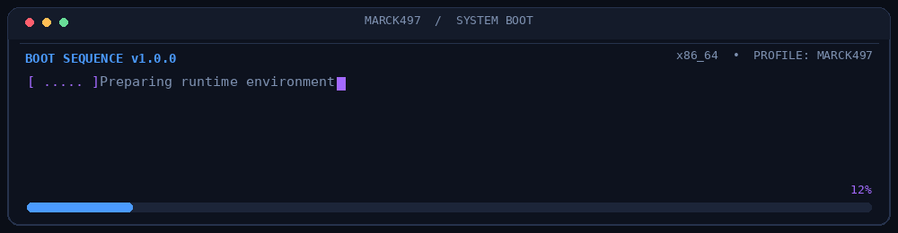

<!-- =========================================================
     MARCK497 | GITHUB PROFILE README
     Repository: Marck497/Marck497
     Theme: Midnight Blue • Electric Blue • Purple
========================================================== -->

<!-- ====================== BOOT SEQUENCE ====================== -->

  

<!-- ============================ INTRO ============================ -->

<h1 align="center">Hey there, I'm Marcos</h1>

<h3 align="center">
  Computer Engineering Student · Developer · Technology Enthusiast
</h3>

  

<!-- ========================= PROFILE BADGES ====================== -->

  
  
 

 

---

<!-- ============================ ABOUT ME ========================= -->

<h2 align="center">About Me</h2>

<table width="100%" border="0" cellspacing="0" cellpadding="12">
  <tr>
    <td width="65%" valign="middle">
      

        I'm a Computer Engineering student passionate about software
        development, systems programming, and understanding how technology
        works under the hood.
      

      

        I enjoy learning by building projects, exploring new technologies,
        and continuously improving my programming skills.
      

      <ul>
        <li><strong>Languages:</strong> C++, Python, Java</li>
        <li><strong>Interests:</strong> Systems programming, cybersecurity, software architecture</li>
        <li><strong>Operating System:</strong> Arch Linux</li>
        <li><strong>Tools:</strong> Git, GitHub, VS Code, CMake</li>
        <li><strong>Currently exploring:</strong> Low-level development and cybersecurity</li>
        <li><strong>Philosophy:</strong> Understand the fundamentals. Build things. Keep improving.</li>
      </ul>
      

        My goal is to become a well-rounded software engineer by developing
        practical projects, learning from the community, and contributing to
        interesting open-source initiatives.
      

    </td>
    <td width="35%" align="center" valign="middle">
      
       
       
      <strong>Curiosity drives innovation.</strong>
       
      One commit at a time.
    </td>
  </tr>
</table>

 

---

<!-- ============================ TECH STACK ======================= -->

<h2 align="center">Tech Stack &amp; Tools</h2>

  Technologies I use, explore, and build with.

  <picture>
    <source
      media="(prefers-color-scheme: dark)"
      srcset="https://skillicons.dev/icons?i=cpp%2Cpython%2Cjava%2Cbash%2Clinux%2Carch%2Cgit%2Cgithub%2Cvscode%2Ccmake&amp;theme=dark&amp;perline=5"
    />
    <source
      media="(prefers-color-scheme: light)"
      srcset="https://skillicons.dev/icons?i=cpp%2Cpython%2Cjava%2Cbash%2Clinux%2Carch%2Cgit%2Cgithub%2Cvscode%2Ccmake&amp;theme=light&amp;perline=5"
    />
    
  </picture>

 

---

<!-- =========================== GITHUB STATS ====================== -->

<h2 align="center">GitHub Analytics</h2>

  <em>Consistency, curiosity, and continuous improvement.</em>

<!-- GITHUB STREAK -->

  

 

<!-- CONTRIBUTION ACTIVITY GRAPH -->

  

 

---

<!-- ======================== CONTRIBUTION SNAKE =================== -->

<h2 align="center">Contribution Snake</h2>

  <em>Every contribution is another step forward.</em>

<!--
  GITHUB ACTION SETUP

  Create this file:
  .github/workflows/snake.yml

  Use Platane/snk to generate the contribution snake.
  Publish the generated SVG files to the "output" branch.

  Repository:
  https://github.com/Platane/snk

  Expected files in the output branch:
  - github-contribution-grid-snake.svg
  - github-contribution-grid-snake-dark.svg

  Ensure GitHub Actions has permission to write repository contents.
  Run the workflow once to generate the initial SVG files.
-->

  <picture>
    <source
      media="(prefers-color-scheme: dark)"
      srcset="https://raw.githubusercontent.com/Marck497/Marck497/output/github-contribution-grid-snake-dark.svg"
    />
    <source
      media="(prefers-color-scheme: light)"
      srcset="https://raw.githubusercontent.com/Marck497/Marck497/output/github-contribution-grid-snake.svg"
    />
    
  </picture>

 

---

<!-- ============================ CONNECT ========================== -->

<h2 align="center">Connect With Me</h2>

  Always open to discussing programming, technology, open source,
  and interesting projects.

  </a>
  

 

<!-- ============================= QUOTE =========================== -->

  <strong>Building. Learning. Improving.</strong>

  
    Thanks for stopping by! Feel free to explore my repositories
    and follow my journey.
  

<!-- ============================ FOOTER =========================== -->

  

<!-- =========================== END README ======================== -->
